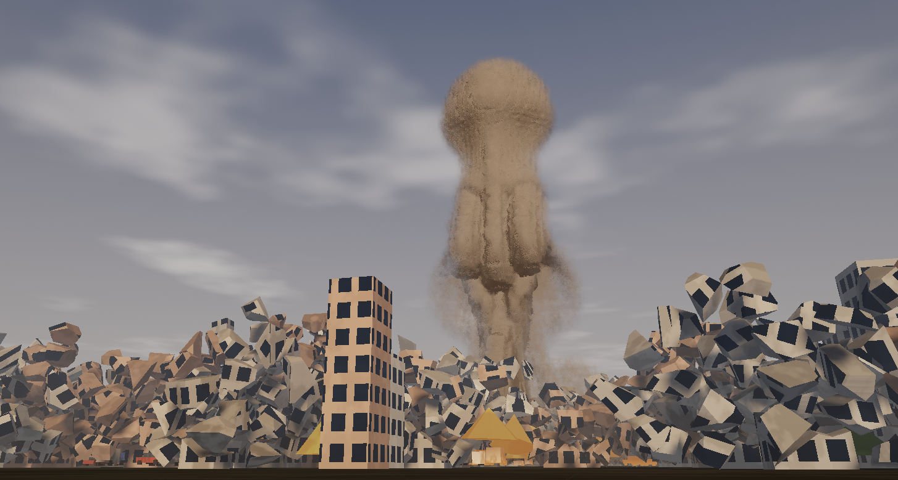

# Explosion Simulator

**Physically based, real-time 3D blast visualisation for Windows x64.**

[](https://github.com/Grownz/ExplosionSim/actions/workflows/build.yml)
[](CHANGELOG.md)



A native C++20 application that couples a reduced-order blast model with a Direct3D 11
volumetric renderer. The reference scenario is a **200 g TNT charge detonated 2 s after
start-up at 0.4 m above the ground**.

## Features

- **Physically grounded blast model** – Brode overpressure fit, Rankine-Hugoniot shock
  speed, Sedov-like fireball growth, buoyant mushroom-cloud dynamics, thermal radiation
  and Gurney-driven debris. All parameters are in SI units and exposed in the UI.
- **Real-time volumetric rendering** – the fireball, shock front and smoke field are
  baked into a 3D texture on a worker pool and ray-marched on the GPU with
  emission/absorption, blackbody colour, single scattering and HDR bloom.
- **Multithreading** – a work-stealing thread pool parallelises particle integration and
  volume baking; the render thread always participates in the work.
- **Cinematic particles** – instanced billboards for glowing debris, sparks, turbulent
  flame tongues, soot and shock-driven ground dust.
- **Physical analysis panel** – live shock radius/Mach, peak overpressure, 5 psi and
  1 psi damage radii, thermal burn radius, observer arrival time and a Friedlander
  pressure waveform.
- **Grid overlay with an adaptive metre scale** – the scale bar snaps to a 1-2-5
  sequence and keeps a readable size while zooming.
- **High-fidelity GPU mode** – an optional 3D compressible Euler solver (HLLC fluxes,
  MUSCL reconstruction, CFL-adaptive time step) runs on the GPU at 64³–128³ and drives
  the volumetric field. Selectable under *Physics & Effects → Simulation model*.
- **2 s fuse** – the charge is armed on start-up, a countdown is shown, then the
  detonation is simulated in slow motion (time scale is adjustable).
- **Headless capture** – deterministic PNG screenshots and a benchmark mode without a
  window, ideal for CI and documentation.
- **No runtime dependencies** – static MSVC runtime, no VC++ redistributable, single
  executable plus the shader folder.

## Requirements

| | |
|---|---|
| OS | Windows 10 / 11 x64 |
| GPU | Direct3D 11 capable (feature level 11_0), 2 GB VRAM recommended |
| Build | Visual Studio 2022 Build Tools (MSVC), CMake ≥ 3.21 |
| Network | required once, to download Dear ImGui |

## Build

```powershell
cmake -S . -B build -G "Visual Studio 17 2022" -A x64
cmake --build build --config Release --parallel
```

The executable is written to `build\Release\ExplosionSim.exe`; the `assets` folder is
copied next to it automatically.

Run the tests:

```powershell
ctest --test-dir build -C Release --output-on-failure
```

## Run

```powershell
.\build\Release\ExplosionSim.exe
```

The application opens a window, arms the 200 g charge and detonates after two seconds.

### Controls

| Input | Action |
|---|---|
| Left mouse drag | Orbit camera |
| Right / middle mouse drag | Pan camera |
| Mouse wheel | Zoom |
| Space | Pause / resume |
| R | Rearm (restart with fuse) |
| F | Frame the blast |
| H | Hide / show the interface |
| F12 | Save a PNG screenshot next to the executable |

### Command line

```text
--screenshot <path>   render a deterministic PNG and exit (headless)
--time <seconds>      simulation time after detonation (default 0.12)
--width <pixels>      output width (default 1600)
--height <pixels>     output height (default 900)
--charge <kg>         TNT equivalent mass
--hob <metres>        height of burst
--azimuth <degrees>   camera azimuth for headless captures
--elevation <degrees> camera elevation for headless captures
--benchmark           render frames offscreen and print timing
--frames <count>      number of benchmark frames (default 120)
--high-fidelity       use the GPU Euler solver for the volume
--solver-resolution   solver grid resolution (64, 96 or 128)
--solver-steps        solver steps per frame (default 24)
--solver-time <s>     solver time for headless captures
--no-vsync            disable vertical synchronisation
--debug               enable the D3D11 debug layer
--help                show all options
```

Examples:

```powershell
# 1920x1080 hero image, 100 ms after detonation
.\build\Release\ExplosionSim.exe --screenshot hero.png --time 0.1 --width 1920 --height 1080

# GPU benchmark at 1080p
.\build\Release\ExplosionSim.exe --benchmark --frames 300 --width 1920 --height 1080
```

## Scenario defaults

| Parameter | Value |
|---|---|
| Charge | 200 g TNT equivalent (837 kJ) |
| Height of burst | 0.4 m |
| Fuse | 2.0 s |
| Ambient conditions | 15 °C, 1013 hPa, 1 m/s wind |
| Time scale | 0.06 (slow motion) |
| Loop | off |
| Grid overlay | on |
| Loop duration | 0.55 s of simulated time |

The charge, height of burst, atmosphere and fuse can be changed in the control panel.
Presets from 20 g to 1 t are included; the model remains continuous over a much wider
range.

## Simulation models

| Model | Description | Best for |
|---|---|---|
| **Reduced-order** (default) | Validated engineering blast model with analytic fireball, cloud, debris, sparks, smoke and dust. Covers the complete timeline. | Overview, full event, particles |
| **High-fidelity (GPU Euler)** | 3D compressible Euler finite-volume solver with HLLC fluxes and MUSCL reconstruction, running in D3D11 compute shaders. | Early blast (0–50 ms), shock structure, fireball dynamics |

The high-fidelity mode is a genuine numerical solution, not a visual approximation, but
it is deliberately slow-motion: 24 solver steps per frame at 128³ advance roughly
0.3–0.5 ms of physical time per frame. Particle rendering is disabled in this mode
because the volume is the physical solution. For a headless capture use e.g.
`--high-fidelity --time 0.005`.

High-fidelity settings (Physics & Effects panel):

- Grid resolution: 64³ / 96³ / 128³
- Solver steps per frame: 4–64
- Domain: ten times the analytic fireball radius, cubic, with a reflecting ground and
  open lateral/top boundaries

## Physics

The simulation is a **reduced-order model**, not a computational fluid dynamics solve:
it reproduces the integral behaviour of a blast (front trajectory, overpressure,
fireball growth, cloud rise, thermal output) at interactive rates. The equations and the
underlying references are documented in [docs/physics.md](docs/physics.md).

Implemented effects:

- Hopkinson-Cranz scaled distance and Brode's incident overpressure fit
- Rankine-Hugoniot shock Mach number and adaptive shock-front integration
- Fireball growth, surface temperature and Planckian (blackbody) emission
- Buoyant thermal cloud with entrainment drag and wind advection
- Thermal radiation fluence and burn radius
- Drag/gravity/bounce debris, sparks, soot and shock-lifted dust
- Friedlander blast waveform for an observer at a chosen distance

## Rendering

- 96³ (configurable) RGBA32F volume, baked on the worker pool at up to 30 Hz
- GPU ray marching with jittered sampling, emission/absorption and Henyey-Greenstein
  scattering
- Instanced billboard particles with soft depth fade
- Procedural sky, terrain, scorch marks, blast ring and fireball ground lighting
- HDR render target, 5-level bloom pyramid, ACES filmic tonemap

The renderer is described in [docs/architecture.md](docs/architecture.md).

## Packaging a release

```powershell
powershell -ExecutionPolicy Bypass -File scripts/package-release.ps1
```

This builds the Release configuration and creates
`build\ExplosionSim-0.1.0-win64.zip`, containing the executable, the shader assets and
the documentation.

## Project layout
```
assets/shaders/     HLSL shaders (loaded at runtime)
docs/               physics and architecture documentation
src/app/            window, frame loop, settings persistence
src/core/           thread pool, RNG, logging
src/gfx/            D3D11 device, renderer, camera, shaders, image I/O
src/sim/            blast model, particles, volume baking, simulation
src/ui/             Dear ImGui interface
tests/              physics regression tests
```

## License

MIT – see [LICENSE](LICENSE).

## Versioning

The project uses [Semantic Versioning](https://semver.org/). The current version is
**0.1.0**; see [CHANGELOG.md](CHANGELOG.md) for the release history. Version information
is generated by CMake from the `project()` declaration and embedded in the executable.

