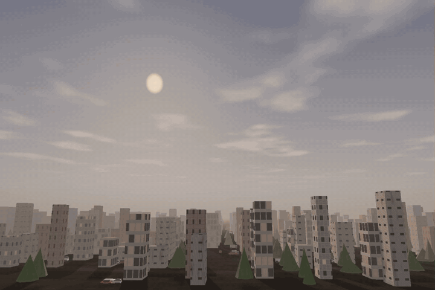
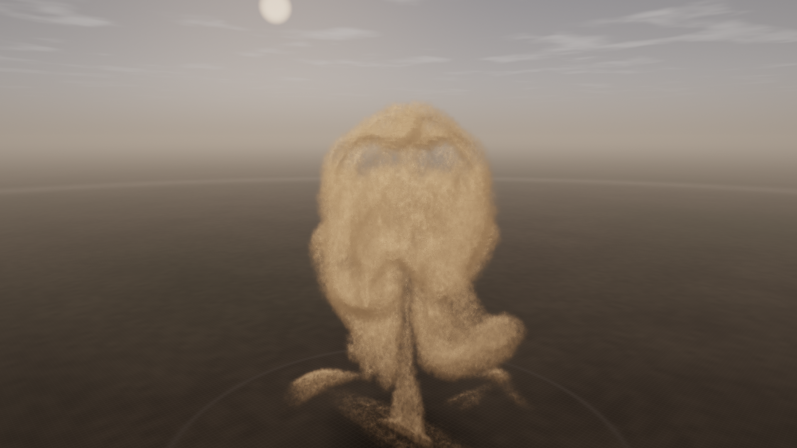

# Explosion Simulator

**Physically based, real-time 3D blast visualisation for Windows x64.**

[](https://github.com/Grownz/ExplosionSim/actions/workflows/build.yml)
[](CHANGELOG.md)



*17-second promo – [full-quality MP4](docs/screenshots/promo-0.10.0.mp4).*

A native C++20 / Direct3D 11 application that couples an engineering blast model
with a volumetric renderer and an optional GPU compressible-flow solver. The
reference scenario is a **200 g TNT charge at 0.4 m height of burst**; the charge,
atmosphere and environment are fully interactive.

## What makes it different

- **The pressure wave is visible in the air** – the compressed shell around the
  front is rendered as a weak lens. Its refractive-index jump follows the
  Gladstone-Dale relation and the Rankine-Hugoniot density ratio, so the sky,
  smoke and town behind the front are bent in screen space. A faint caustic rim
  and slight dispersion keep the front readable.
- **Two physically consistent models** – a validated reduced-order blast model
  covers the complete event, while an optional 3D compressible Euler solver
  (HLLC fluxes, MUSCL reconstruction, CFL time step) resolves the early shock
  and fireball on the GPU. Both share the same atmosphere, charge and camera.
- **A town that actually breaks** – a deterministic procedural town is fractured
  into Voronoi chunks, shielded by neighbouring buildings and collapsed
  progressively by the analytic pressure-impulse field. Ten different low-poly
  vehicle models and the trees become rigid bodies; debris piles up on the
  remaining structure.
- **Heat has a direction** – only the surface facing the burst glows and emits
  flames. Short ember streaks leave the outer edges of that face; the leeward
  side keeps its charred material colour.
- **Volumetric fire and smoke** – the fireball, shock shell and mushroom cloud
  live in a 64³–1024³ volume with Planckian emission, absorption, single
  scattering, self-shadowing and a GPU bake that follows the growing cloud.
- **Live physical analysis** – shock radius and Mach number, peak overpressure,
  5 psi / 1 psi damage radii, thermal burn radius, observer arrival time and a
  Friedlander pressure waveform.
- **No runtime dependencies** – static MSVC runtime, no VC++ redistributable,
  one executable plus the shader assets.

## Physics

The reduced-order model reproduces the integral behaviour of a blast at
interactive rates; it is not a CFD solve. The high-fidelity mode is a genuine
finite-volume Euler solution. Equations, assumptions and references are in
[docs/physics.md](docs/physics.md).

| Principle | Used for |
|---|---|
| Hopkinson-Cranz scaling and Brode's fit | Incident overpressure versus distance |
| Rankine-Hugoniot relations | Shock Mach number, density and temperature jump |
| Sedov-like fireball growth and Planckian blackbody | Fireball radius, surface temperature and colour |
| Buoyant thermal with entrainment and wind | Mushroom-cloud rise, cap and drift |
| Thermal fluence | Burn radius and ignition of scene objects |
| Friedlander waveform | Pressure history at a fixed observer |
| Gurney velocity and quadratic drag | Debris, sparks and ground dust |
| Gladstone-Dale relation | Atmospheric shock-front refraction |
| Moist-air density and Sachs scaling | Sound speed, humidity and altitude effects |

## Simulation modes

| Model | Description | Best for |
|---|---|---|
| **Reduced-order** (default) | Engineering blast model with analytic fireball, cloud, debris, sparks, smoke and dust. Covers the full timeline. | Overview, complete event, particles |
| **High-fidelity (GPU Euler)** | 3D compressible Euler finite-volume solver in D3D11 compute shaders. Cube or masked hemisphere, 64³–512³, with GPU domain auto-scaling. | Early blast, shock structure, fireball dynamics |

The high-fidelity solver follows the playback time scale and disables particle
rendering because the volume is the physical solution. A sub-grid entrainment and
vortex-ring closure represents the mushroom cap that the coarse grid cannot
resolve. Use `--high-fidelity --time 0.005` for a headless early-blast capture.



*GPU Euler solver, 128³, 1 t surface burst, 1920×1080 headless capture.*

## Rendering

- GPU ray marching through the volume with jittered sampling, emission/absorption,
  Henyey-Greenstein scattering and gradient-based sun shading.
- Auto-scaling volume box: it grows with the fireball and cloud while the voxel
  count stays fixed, so the bake cost remains constant.
- Opaque procedural scene (instanced buildings, vehicles, trees and rubble)
  before the volume, so depth correctly occludes the fireball and smoke.
- Directional shadow map, procedural sky and terrain, scorch marks, blast ring,
  ground lighting, instanced particles, HDR bloom and ACES tonemapping.
- Dedicated atmospheric-refraction pass between the scene/volume and bloom.

Implementation details are in [docs/architecture.md](docs/architecture.md).

## Requirements and build

| | |
|---|---|
| OS | Windows 10 / 11 x64 |
| GPU | Direct3D 11 capable (feature level 11_0), 2 GB VRAM recommended |
| Build | Visual Studio 2022 Build Tools (MSVC), CMake ≥ 3.21 |
| Network | required once, to download Dear ImGui and Jolt Physics |

```powershell
cmake -S . -B build -G "Visual Studio 17 2022" -A x64
cmake --build build --config Release --parallel
ctest --test-dir build -C Release --output-on-failure
```

The executable is written to `build\Release\ExplosionSim.exe`; the `assets`
folder is copied next to it. `physics` covers the blast model, atmosphere,
volume baker, scene and settings; `gpu` exercises the Euler solver and is
skipped when no Direct3D 11 device is available.

## Run

```powershell
.\build\Release\ExplosionSim.exe
```

The application opens armed and waits for **Detonate** (or **D**). The charge,
height of burst, atmosphere, fuse, scene and rendering settings are in the
control panel.

### Controls

| Input | Action |
|---|---|
| Left mouse drag | Orbit camera |
| Right / middle mouse drag | Pan camera |
| Mouse wheel | Zoom |
| Space | Pause / resume |
| D | Detonate (when armed) |
| R | Rearm (hold the fuse; Detonate starts the next explosion) |
| F | Frame the blast |
| H | Collapse panel, hide overlays, restore (cycles) |
| F12 | Save a PNG screenshot next to the executable |

The camera stays at least 0.4 m above the ground; the view never ends up under
the terrain.

### Command line

| Option | Purpose |
|---|---|
| `--screenshot <path>` | Render a deterministic PNG and exit (headless) |
| `--time <s>` | Simulation time after detonation (default 0.12) |
| `--width <px>` / `--height <px>` | Output size (default 1600×900) |
| `--charge <kg>` / `--hob <m>` | TNT-equivalent mass and height of burst |
| `--high-fidelity` | Use the GPU Euler solver for the volume |
| `--solver-resolution <n>` / `--solver-time <s>` | Solver grid and capture time |
| `--benchmark` / `--frames <n>` | Offscreen render benchmark |
| `--solver-benchmark` | Solver-only GPU timings |
| `--scene-seed <n>` / `--scene-density <x>` / `--no-scene` | Procedural environment |
| `--no-update-check` / `--check-updates` / `--version` | Update handling and version |
| `--help` | Show every option |

```powershell
# 1920x1080 hero image, 100 ms after detonation
.\build\Release\ExplosionSim.exe --screenshot hero.png --time 0.1 --width 1920 --height 1080

# GPU benchmark at 1080p
.\build\Release\ExplosionSim.exe --benchmark --frames 300 --width 1920 --height 1080
```

## License

MIT - see [LICENSE](LICENSE). Third-party components: Dear ImGui (MIT), Jolt
Physics (MIT), nlohmann/json (MIT), miniz (MIT) and the Kenney Car Kit (CC0);
the miniz license is included as `LICENSE-miniz.txt` in the release archive.

## Versioning

The project uses [Semantic Versioning](https://semver.org/). The current version
is **0.10.5**; see [CHANGELOG.md](CHANGELOG.md) for the release history. Version
information is generated by CMake from the `project()` declaration and embedded
in the executable. The app checks the GitHub releases API once per day and can
install a newer Win64 build after verifying its SHA-256 digest and signature.
